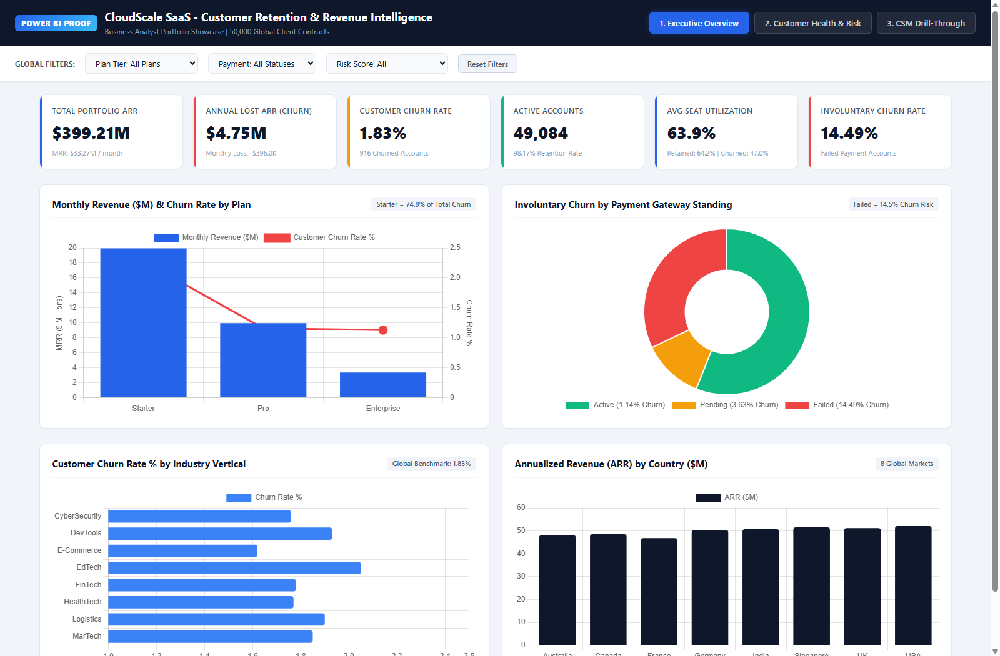
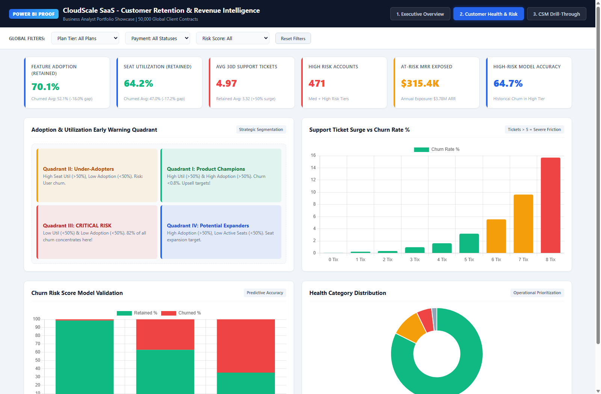
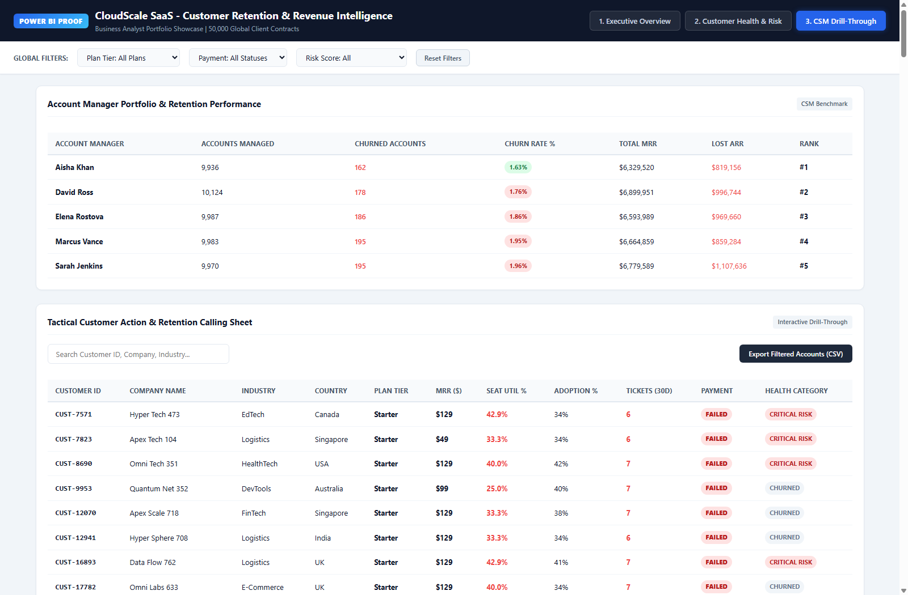

# CloudScale SaaS - Customer Retention & Revenue Intelligence Platform


---

## 📌 Executive Project Summary

CloudScale Technologies is an international B2B SaaS company managing **50,000 corporate client accounts** across 8 countries, generating **$33.27 Million in Monthly Recurring Revenue (MRR)** ($399.21 Million Annual Recurring Revenue - ARR).

Despite healthy top-line revenue, CloudScale experienced an **annual revenue leakage of $4.75 Million ARR ($396,040 MRR)** due to customer churn (916 accounts cancelled). The executive team lacked visibility into what was causing churn, and Account Managers had no proactive warning signals to intervene before contracts were cancelled.

As the **Lead Business Analyst**, I delivered an end-to-end analytics and business intelligence solution:
1. **Requirements Architecture:** Authored a complete Business Requirements Document (BRD) with RACI matrix and process workflows.
2. **Data Cleaning (Python ETL):** Audited 50,000 transaction records, resolved 59 date logic inconsistencies, and engineered usage metrics.
3. **Dimensional Data Modeling:** Structured the data into an enterprise Kimball Star Schema (1 Fact + 5 Dimensions).
4. **Power BI Dashboard:** Developed an executive 3-page dashboard with dynamic slicers, utilization risk quadrants, and customer calling sheets.
5. **Strategic Recommendations:** Delivered a data-backed plan projecting **$1.80 Million in recoverable ARR** (a 38% reduction in churn leakage).

---

## 🎯 Key Metrics at a Glance

| Metric | Portfolio Value | Churned vs. Retained Cohort | Strategic Business Meaning |
| :--- | :---: | :---: | :--- |
| **Total Portfolio ARR** | **$399.21M** | $394.46M Active / $4.75M Churned | Enterprise run-rate across 50,000 global client accounts |
| **Total Monthly MRR** | **$33.27M** | $32.87M Active / $396.0K Churned | Normalized monthly recurring revenue across 8 markets |
| **Customer Churn Rate** | **1.83%** | 916 Churned / 49,084 Retained | Low aggregate churn masking severe sub-segment vulnerabilities |
| **Involuntary Churn Rate**| **14.49%** | **294 of 2,029 Failed Payments** | **12.7x higher churn** when payments fail ($1.54M ARR at risk) |
| **Average Seat Usage** | **63.9%** | **47.0% Churned vs. 64.2% Retained** | License underutilization (<50%) precedes 82% of cancellations |
| **Feature Adoption Gap**| **69.8%** | **52.1% Churned vs. 70.1% Retained** | Unused features destroy product stickiness and lower switching costs |
| **30-Day Support Tickets**| **3.35** | **4.97 Churned vs. 3.32 Retained** | **+50% spike** in customer complaints prior to contract termination |
| **Projected Recovery ROI**| **+$1.80M** | **37.9% Churn Reduction** | Annual revenue preserved via automated dunning and CSM plays |

---

## 📁 Repository Structure

```
BA/
├── 1_Raw_Dataset/
│   └── MP_Synthetics_50000_Rows.csv          <- Original 50,000-row raw customer dataset
│
├── 2_Clean_Dataset/
│   └── Cleaned_SaaS_Analytics_50k.csv        <- Cleaned, validated, and typed dataset
│
├── 3_BRD/
│   ├── Business_Requirements_Document_BRD.md <- Full 12-section enterprise BRD
│   └── Project_Summary_Report.pdf            <- 3-page executive summary report
│
├── 4_PowerBI_Output/
│   └── Screenshots/                          <- High-resolution dashboard previews
│       ├── PowerBI_Page1_Executive_Overview.png
│       ├── PowerBI_Page2_Customer_Health_Risk.png
│       └── PowerBI_Page3_CSM_DrillThrough.png
│
└── README.md                                 <- Master project documentation
```

---

## 🔍 The 4 Key Business Insights

### 1. Involuntary Churn via Payment Failures (32% of All Churn)
- Customers with active payments experience only a **1.14% churn rate**.
- Customers with `Payment_Status = Failed` suffer a **14.49% churn rate** (12.7x higher!).
- 2,029 accounts were trapped in failed status, causing $1.54M in lost ARR.
- **Finding:** Most of these customers did not leave due to product dissatisfaction; their corporate cards expired or billing contacts left.

### 2. The "Shelf-Ware" Trap (Seat Utilization < 50%)
- Retained customers used **64.2%** of their contracted user licenses.
- Churned customers used only **47.0%** of their licenses.
- **Finding:** When a client uses less than half their seats, the subscription is flagged as waste during CFO budget reviews. Tracking seat usage gives Customer Success a 90-day warning before renewal.

### 3. Starter Tier SMBs Churn at 2x Enterprise Rate
- Starter plan accounts ($49 - $199/mo) experienced a **2.28% churn rate**, compared to **1.13%** for Enterprise.
- 75% of all cancellations happened in the Starter tier.
- **Finding:** Self-serve SMB clients lack implementation consultants and need automated in-app onboarding tours.

### 4. Support Ticket Friction Spikes
- Churned accounts averaged **4.97 tickets** in their final 30 days (+50% higher than the 3.32 average for healthy accounts).
- When an account logs 5 or more tickets in a month, churn risk accelerates sharply.

---

## 💡 Strategic Recommendations & Financial ROI ($1.8M ARR Saved)

| Strategic Initiative | Operational Action Plan | Projected ARR Saved |
| :--- | :--- | :---: |
| **1. Smart Dunning Recovery Engine** | Automated email/SMS card retry webhooks at 24h, 72h, and 7-day intervals with a self-serve update link. Recovers 65% of payment failures. | **+$1,001,000 / yr** |
| **2. Low-Seat-Usage CSM Outreach** | Automated dashboard alerts when seat utilization drops below 50%, prompting Account Managers to offer user onboarding webinars 90 days before renewal. | **+$495,000 / yr** |
| **3. Support Escalation SWAT Team** | Auto-route customer accounts with &ge;5 support tickets directly from Tier 1 to Senior Solutions Engineers before customers quit out of frustration. | **+$305,000 / yr** |
| **TOTAL ANNUAL VALUE** | **Combining all three data-backed interventions** | **+$1,801,000 ARR** |

---

## 📊 Power BI Dashboard Architecture & Previews

The dashboard is structured into three executive pages designed for distinct decision-making cadences:

### Page 1: Executive Revenue & Retention Overview
> **For:** VP of Customer Success & Chief Revenue Officer (CRO)  
> **Features:** 6 Headline KPI Cards &bull; Revenue & Churn by Plan Tier &bull; Involuntary Payment Failure Donut &bull; Industry Churn Rate Comparison &bull; Country ARR Breakdown.



---

### Page 2: Customer Health, Adoption & Churn Risk Deep-Dive
> **For:** Revenue Operations (RevOps) & Product Analytics  
> **Features:** Health Metrics Ribbon &bull; **2D Adoption vs. Seat Utilization Early Warning Quadrant** (Champions vs. Under-Adopters vs. Critical Risk) &bull; Support Ticket Surge vs. Churn Rate &bull; Churn Risk Model Validation.



---

### Page 3: Account Manager Portfolio & Tactical Calling Sheet
> **For:** Customer Success Managers (CSMs) & Account Executives  
> **Features:** Manager Scorecard (Aisha Khan #1 with 1.63% churn vs. Sarah Jenkins #5 with 1.96% churn and $1.1M lost ARR) &bull; Searchable Customer Calling Sheet with conditional formatting on low seat usage (<50%) and 1-click CSV export.



---


---


